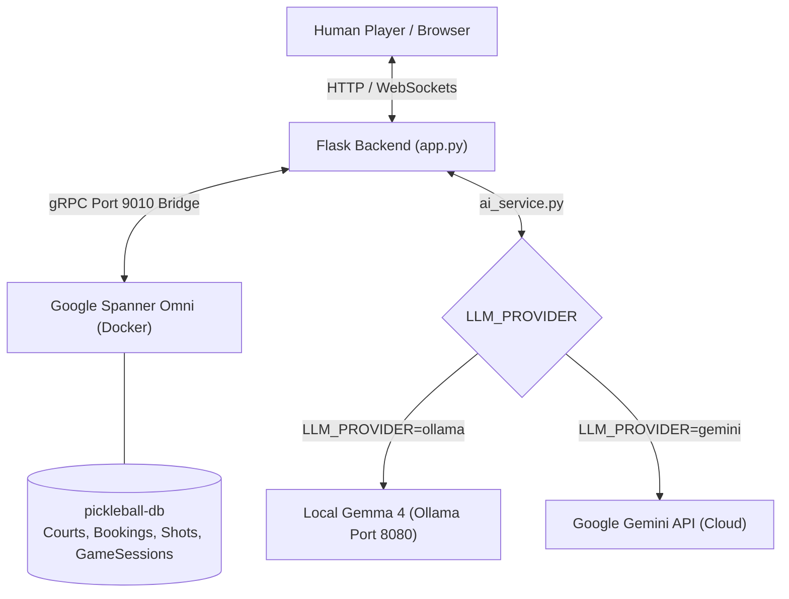

# Spanner Omni GraphRAG Pickleball Coach 🏓

An interactive Pickleball Tactical Game Arena powered by **Google Cloud Spanner Omni** (distributed ACID consistency and graph telemetry) with a modular AI coaching architecture supporting **Local Gemma 4 (via Ollama)** and **Google Gemini API**.

---

## 📖 Description

The Spanner Omni GraphRAG Pickleball Coach is a full-stack tactical simulation arena. Players control a paddle in a 2.5D court canvas against an adaptive autonomous bot ("OmniBot-3000"). Every rally, shot, and outcome is recorded into Google Cloud Spanner Omni as relational records and graph nodes. An agentic AI coach delivers instant tactical feedback and referee rulings, grounded directly in live Spanner database state.

---

## 🎮 Demo & Interactive Arena

When launched at `http://localhost:5000`:

1. **2.5D Animated Game Arena**: Real-time canvas rendering at 60 FPS with physics for dinks, speedups, 3rd-shot drops, and offensive lobs.
2. **Dynamic AI Tactical Coach**: Instant coaching analysis following each exchange and point fault.
3. **Spanner Omni Facility Grounding**: The AI Concierge answers rules questions and provides court booking recommendations using real-time ACID database snapshots.
4. **Interactive Facility Deck**: Live court reservations, matchmaking requests, and DUPR player profiles backed by Spanner.

---

## 🏷️ Original Source & Acknowledgements

This project is an extended implementation based on the original Spanner Omni Pickleball Game created by **Abirami Sukumaran** ([AbiramiSukumaran](https://github.com/AbiramiSukumaran)), available at:

[https://github.com/AbiramiSukumaran/pickleball](https://github.com/AbiramiSukumaran/pickleball)

The original project established the foundation for the visual pickleball court arena, Spanner Omni integration concept, and Gemini coaching prompts. This repository documents local deployment, architectural extensions, and verified offline capabilities created on top of that work.

---

## 📦 What the Original Project Provides

- 2.5D visual pickleball court canvas and ball trajectory animation.
- Table schema definitions for courts, players, bookings, match requests, zones, shots, transitions, and game sessions.
- Synthesized Web Audio API sound effects for paddle hits, bounce thuds, and speedup swooshes.
- Foundational prompt structure for Gemini coaching.
- Single-page dashboard interface styled with Tailwind CSS.

---

## ✨ Local Extensions & Verified Enhancements

Developed and verified by **Shivakumar Sullagaddi** ([Shivakumarsullagaddi](https://github.com/Shivakumarsullagaddi)):

1. **Modular Dual-Provider AI Interface ([`ai_service.py`](file:///D:/code_vipasana/pickleball/ai_service.py))**:
   - Decoupled AI generation into a provider-independent service.
   - Built [`OllamaProvider`](file:///D:/code_vipasana/pickleball/ai_service.py) connecting to local Gemma 4 (`gemma4:e2b`).
   - Retained [`GeminiProvider`](file:///D:/code_vipasana/pickleball/ai_service.py) connecting to Google Gemini API (`gemini-3.8-flash`).
   - Enabled runtime provider switching with single `LLM_PROVIDER` environment variable.
   - Implemented automated thinking tag stripping (`<thought>...</thought>`) for local models.
   - Prevented silent cross-provider fallbacks.

2. **Spanner Omni Container Bridging & Windows Compatibility**:
   - Established automated port forwarder bridging container port 9010 to Spanner single-server port 15000.
   - Resolved Windows console `UnicodeEncodeError` by ensuring UTF-8 stdout configuration.
   - Fixed database creation DDL statement application to align with modern `google-cloud-spanner` v3.40+ library standards.
   - Added automatic fallback between `default/default` and emulator configurations.

3. **Dynamic Frontend Health Reporting**:
   - Upgraded [`templates/index.html`](file:///D:/code_vipasana/pickleball/templates/index.html) to dynamically query `/api/status` and display real-time provider and reachability badges.

4. **Automated Unit & Integration Test Suite ([`test_ai_service.py`](file:///D:/code_vipasana/pickleball/test_ai_service.py))**:
   - 20 comprehensive unit and route tests verifying provider selection, timeout enforcement, failure handling, route compatibility, and credential leak prevention.

5. **Security & Documentation Suite**:
   - Isolated credentials via `.env.example` and strict `.gitignore` rules.
   - Created a 7-document technical guide in [`docs/`](file:///D:/code_vipasana/pickleball/docs/README.md).

---

## 🏛️ Architecture Overview



---

## 💻 Technologies Used

- **Backend**: Python 3.13, Flask 3.0, Gunicorn, python-dotenv
- **Database**: Google Cloud Spanner Omni (`us-docker.pkg.dev/spanner-omni/images/spanner-omni:2026.r2.1-beta`)
- **Database Client**: `google-cloud-spanner>=3.40.0`
- **Local AI Engine**: Ollama, Gemma 4 (`gemma4:e2b`)
- **Cloud AI Engine**: Google Gemini API (`google-genai>=1.0.0`)
- **Frontend**: HTML5 Canvas, Tailwind CSS, FontAwesome, Web Audio API
- **Testing**: Python standard library `unittest`

---

## 📋 Prerequisites

- **Operating System**: Windows 11 (64-bit), macOS, or Linux
- **Terminal**: Windows PowerShell 5.1+ or PowerShell 7+
- **Docker Desktop**: Running with WSL 2 backend
- **Python**: Version 3.11, 3.12, or 3.13
- **Git**: Installed and configured

---

## 📂 Repository Structure

```text
Spanner-Omni-GraphRAG-Pickleball-Coach/
├── README.md
├── LICENSE
├── requirements.txt
├── .gitignore
├── .env.example
├── app.py
├── ai_service.py
├── test_ai_service.py
├── templates/
│   └── index.html
└── docs/
    ├── README.md
    ├── 01-project-overview.md
    ├── 02-local-setup-windows.md
    ├── 03-environment-and-credentials.md
    ├── 04-spanner-omni-guide.md
    ├── 05-ai-providers-gemini-and-ollama.md
    ├── 06-testing-and-verification.md
    └── 07-contribution-and-attribution.md
```

---

## 🚀 Local Installation Steps

### 1. Clone Repository

```powershell
git clone https://github.com/Shivakumarsullagaddi/Spanner-Omni-GraphRAG-Pickleball-Coach.git
cd Spanner-Omni-GraphRAG-Pickleball-Coach
```

---

## 🗄️ Spanner Omni Setup

### 1. Initial Container Run (First Time)

```powershell
docker volume create spanner_omni_data
docker run -d --name spanner-omni -p 9010:9010 -p 9020:9020 -v spanner_omni_data:/spanner us-docker.pkg.dev/spanner-omni/images/spanner-omni:2026.r2.1-beta start-single-server
```

### 2. Restarting Existing Container

```powershell
docker start spanner-omni
```

### 3. Port Bridge Forwarder

Spanner Omni single-server listens on internal port 15000:

```powershell
docker exec -d spanner-omni nc -L -p 9010 nc 127.0.0.1 15000
```

---

## 🐍 Python Environment Setup

```powershell
python -m venv .venv
.\.venv\Scripts\Activate.ps1
pip install -r requirements.txt
```

---

## ⚙️ Environment Configuration

Copy the example configuration:

```powershell
Copy-Item .env.example .env
```

Select your desired AI provider inside `.env`:

### Mode A: Local Gemma 4 (Default)

```dotenv
LLM_PROVIDER=ollama
OLLAMA_BASE_URL=http://localhost:8080
OLLAMA_MODEL=gemma4:e2b
OLLAMA_TIMEOUT_SECONDS=180
GEMINI_API_KEY=
GEMINI_MODEL=gemini-3.8-flash
LLM_LOG_LEVEL=INFO
SPANNER_EMULATOR_HOST=localhost:9010
SPANNER_PROJECT=default
SPANNER_INSTANCE=default
SPANNER_DATABASE=pickleball-db
PORT=5000
```

### Mode B: Hosted Google Gemini API

```dotenv
LLM_PROVIDER=gemini
OLLAMA_BASE_URL=http://localhost:8080
OLLAMA_MODEL=gemma4:e2b
OLLAMA_TIMEOUT_SECONDS=180
GEMINI_API_KEY=AIzaSyYourGeminiApiKeyHere
GEMINI_MODEL=gemini-3.8-flash
LLM_LOG_LEVEL=INFO
SPANNER_EMULATOR_HOST=localhost:9010
SPANNER_PROJECT=default
SPANNER_INSTANCE=default
SPANNER_DATABASE=pickleball-db
PORT=5000
```

---

## 🔑 Gemini API Setup (When LLM_PROVIDER=gemini)

1. Obtain a Gemini API Key from Google AI Studio (`https://aistudio.google.com/`).
2. Set `GEMINI_API_KEY` in `.env`.
3. Set `LLM_PROVIDER=gemini`.

---

## 🦙 Local Gemma 4 / Ollama Setup (When LLM_PROVIDER=ollama)

Start the existing local Ollama container:

```powershell
docker start gemma4-ollama-instance
```

Verify that model `gemma4:e2b` is available:

```powershell
docker exec gemma4-ollama-instance ollama list
```

---

## 🏃 Running the Application

```powershell
$env:PYTHONUTF8="1"
python app.py
```

Access the arena at:

`http://localhost:5000`

---

## 🔍 Health Checks & Verification

### Status Check

```powershell
Invoke-RestMethod -Uri "http://localhost:5000/api/status" -Method Get
```

### Run Automated Tests

```powershell
$env:PYTHONUTF8="1"
python -m unittest test_ai_service.py
```

---

## 🔧 Troubleshooting

- **Windows Console UnicodeEncodeError**: Set `$env:PYTHONUTF8="1"` before running `python app.py`.
- **Port 8080 Connection Refused**: Start the Ollama container with `docker start gemma4-ollama-instance`.
- **Inference Timeout**: Local inference on CPU can take 40-90 seconds. Increase `OLLAMA_TIMEOUT_SECONDS` if needed.
- **Spanner Connection Refused**: Run the port bridge forwarder `docker exec -d spanner-omni nc -L -p 9010 nc 127.0.0.1 15000`.

---

## 🔒 Security & Credentials

- `.env` is ignored by Git and never committed.
- API keys are validated in memory and never logged to console or files.
- Correlation IDs are logged for request traceability without exposing sensitive payloads.

---

## 📚 Documentation Index

Detailed technical guides are available in the [`docs/`](file:///D:/code_vipasana/pickleball/docs/README.md) directory:

- [`01 - Project Overview`](file:///D:/code_vipasana/pickleball/docs/01-project-overview.md)
- [`02 - Windows Local Setup Guide`](file:///D:/code_vipasana/pickleball/docs/02-local-setup-windows.md)
- [`03 - Environment Configuration & Credentials`](file:///D:/code_vipasana/pickleball/docs/03-environment-and-credentials.md)
- [`04 - Google Cloud Spanner Omni Guide`](file:///D:/code_vipasana/pickleball/docs/04-spanner-omni-guide.md)
- [`05 - AI Providers: Gemini & Ollama Gemma 4`](file:///D:/code_vipasana/pickleball/docs/05-ai-providers-gemini-and-ollama.md)
- [`06 - Testing & Verification Guide`](file:///D:/code_vipasana/pickleball/docs/06-testing-and-verification.md)
- [`07 - Contribution & Attribution Notice`](file:///D:/code_vipasana/pickleball/docs/07-contribution-and-attribution.md)

---

## ⚠️ Known Limitations

- Local CPU inference with Gemma 4 takes approximately 45 to 90 seconds per prompt on standard hardware.
- Single-server Spanner Omni runs in standalone development mode without multi-region replication.
- Web browser requires an internet connection for external CDN font and style assets (Tailwind, FontAwesome).

---

## 📄 License & Attribution

This project is licensed under the Apache License, Version 2.0. See [`LICENSE`](file:///D:/code_vipasana/pickleball/LICENSE) for the full text.

Original work Copyright 2026 Google / Abirami Sukumaran.
Local extensions Copyright 2026 Shivakumar Sullagaddi.
